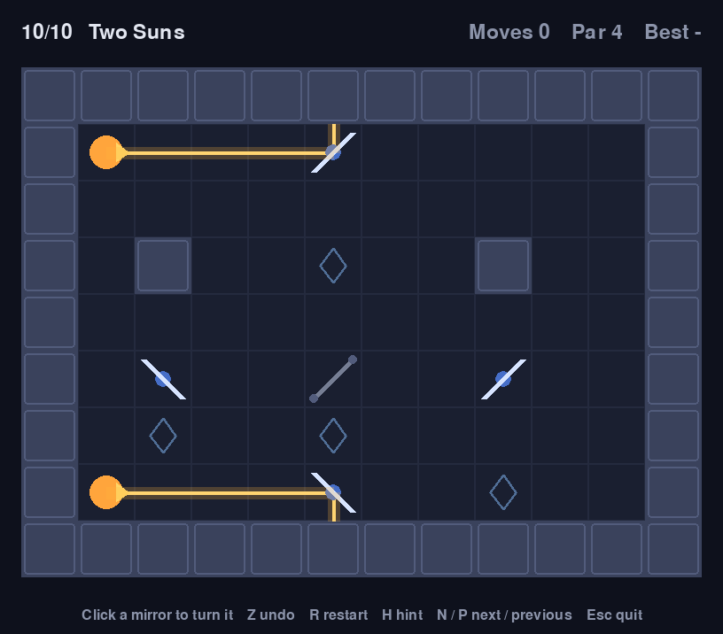
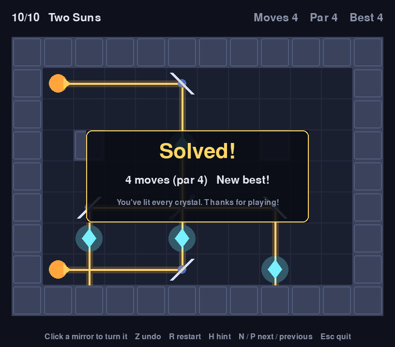

# Lumenpath

[](https://github.com/zeexduaa/lumenpath/actions/workflows/ci.yml)


**A small puzzle game about bending light. Turn the mirrors until every crystal glows.**

Each level is a grid with one or more light emitters, some crystals, and mirrors. Click a mirror to
turn it between `/` and `\`. The beam bounces off mirrors, passes through crystals and stops at walls.
Light up every crystal to solve the level, ideally in as few moves as the par.

| Puzzle | Solved |
| --- | --- |
|  |  |

- **Who it's for:** anyone who likes short, thinky puzzles, and anyone who wants to make their own levels in a text editor.
- **Built with:** Python 3.11+ and [pygame-ce](https://pyga.me/). Tests with pytest, and GitHub Actions runs them on Windows, macOS and Linux (headless).

## Install and play

```bash
pip install git+https://github.com/zeexduaa/lumenpath.git
lumenpath
```

Or from a clone:

```bash
git clone https://github.com/zeexduaa/lumenpath.git
cd lumenpath
pip install -e ".[dev]"
python -m lumenpath
```

## Controls

| Input | Action |
| --- | --- |
| Click a mirror | Turn it |
| `Z` | Undo |
| `R` | Restart the level |
| `H` | Hint: highlights a mirror worth turning |
| `N` / `Enter`, `P` | Next level (once solved), previous level |
| `Esc` | Quit |

Each solve earns stars: three at par, two within two moves of par, one for any other solve. Your progress, best move counts and stars are saved, so the game picks up at your first unsolved level.

```bash
lumenpath --level 3          # jump to a level you've unlocked
lumenpath --reset-progress   # start over
```

## Make your own levels

Levels are plain text files. Here's level 1:

```text
name: First Light
par: 1
---
#######
#>../.#
#.....#
#...o.#
#######
```

| Tile | Meaning |
| --- | --- |
| `#` | Wall, which stops the beam |
| `.` | Empty floor |
| `>` `<` `^` `v` | Emitter, firing in that direction |
| `o` | Crystal, which lights up when a beam passes through |
| `/` `\` | Mirror the player can turn (this is its starting position) |
| `f` `b` | Fixed mirror (`f` = `/`, `b` = `\`) that can't be turned |

`par` is the fewest turns needed. Put your levels in a folder and play them with:

```bash
lumenpath --levels my-levels/
```

The game ships with a brute-force solver. The test suite uses it to check that every bundled level
can be solved, doesn't start solved, and has the right par. The in-game hint uses it too.

## How it's built

```text
src/lumenpath/
  board.py     level format and beam tracing (no pygame, easy to test)
  puzzle.py    one level in play: turning mirrors, undo, hints
  solver.py    finds the fewest mirror turns that light every crystal
  levels/      the bundled levels (*.txt)
  progress.py  saved progress in your user data folder
  game.py      the pygame window: drawing and input
  app.py       command-line entry point
```

## Roadmap

New mechanics (colored light, splitters, portals), an in-game level editor, a level generator,
sound, a browser version and more are planned. See [ROADMAP.md](ROADMAP.md) and the
[issues](https://github.com/zeexduaa/lumenpath/issues).

## Contributing

Bug reports, ideas and especially new levels are welcome. See [CONTRIBUTING.md](CONTRIBUTING.md).

## License

[MIT](LICENSE) © 2026 Syed Ali
